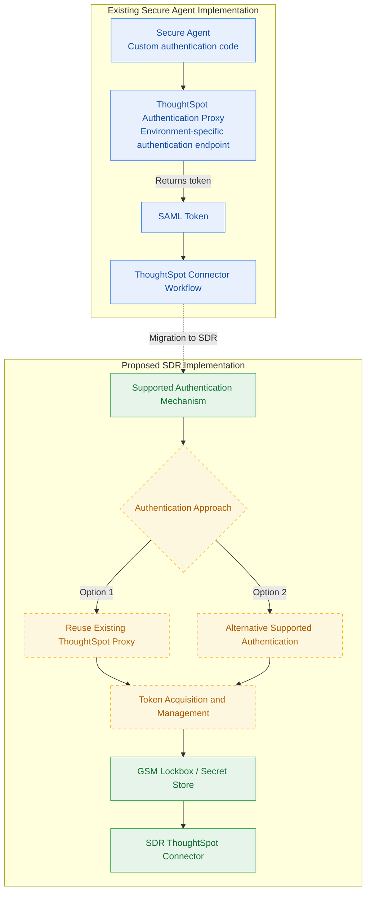

## **ThoughtSpot Connector – Authentication Discussion**

### **1. Existing authentication mechanism (Secure Agent)**

- ThoughtSpot currently uses **SAML-based authentication** through a proxy provided by the internal ThoughtSpot engineering team.
- The existing Secure Agent implementation contains custom authentication code that communicates with this proxy.
- Instead of authenticating directly against the ThoughtSpot instance (DEV, TEST or PROD), the code calls a specific authentication endpoint through the proxy.
- The proxy handles the underlying authentication and returns a SAML token, which is subsequently provided to the connector workflow.
- The existing connector code does not need to understand how the proxy internally performs authentication.

### **2. Authentication challenge with SDR**

The challenge is determining how to replicate or replace the token acquisition mechanism within the SDR architecture.

| Connector   | Authentication mechanism discussed |
| ----------- | ---------------------------------- |
| Snowflake   | OAuth token                        |
| Databricks  | PAT token                          |
| ThoughtSpot | SAML token                         |

For ThoughtSpot, the outstanding questions are:

- How to authenticate against the existing proxy from SDR.
- How to programmatically retrieve the SAML token.
- How to make the token available to the SDR workflow through the secret management mechanism.
- Whether an additional proxy service or custom authentication implementation is required.

### **3. Recommended approach**

Rather than reverse-engineering and replicating the existing Secure Agent authentication implementation, both teams agreed to:

- Review internal ThoughtSpot engineering documentation for officially supported and recommended authentication mechanisms.
- Determine whether an alternative, simpler authentication mechanism is available.
- Check whether the recommended mechanism is already natively supported by Atlan's SDR ThoughtSpot connector.
- Investigate whether the existing local ThoughtSpot proxy running on the VSIs can be reused.
- If no simpler mechanism is available, examine the existing Secure Agent code to reproduce the SAML token acquisition process.

### **4. Conceptual authentication flow**

Existing Secure Agent implementation

**Secure Agent**

Custom authentication code

**ThoughtSpot authentication proxy**

Environment-specific authentication endpoint

**SAML token**

**ThoughtSpot connector workflow**

Proposed SDR implementation — subject to validation

**Supported authentication mechanism**

Existing proxy or alternative mechanism

**Token acquisition and management**

Implementation to be determined

**GSM Lockbox / Secret Store**

**SDR ThoughtSpot connector**

### **5. Next steps**

| Action                                                                   | Owner                                 |
| ------------------------------------------------------------------------ | ------------------------------------- |
| Review internal ThoughtSpot authentication documentation.                | DataCompass                           |
| Identify officially supported authentication mechanisms.                 | DataCompass / ThoughtSpot Engineering |
| Verify native authentication support within the SDR connector.           | Atlan                                 |
| Investigate reuse of the existing ThoughtSpot proxy.                     | Both teams                            |
| Determine token acquisition, renewal and secret management requirements. | Both teams                            |
| Confirm ThoughtSpot migration priority.                                  | DataCompass                           |

### **Conclusion**

The primary blocker is **authentication and token acquisition within the SDR architecture**, rather than a demonstrated failure of the metadata extraction capability.

Both teams agreed to explore a simpler, officially supported authentication mechanism before attempting to replicate the existing custom SAML implementation.

ThoughtSpot migration by November 30 was considered unlikely, and its secondary prioritization remains subject to internal confirmation.

**Note:** The exact authentication endpoints, proxy internals, supported alternatives and token renewal mechanism were not established during the discussion. The proposed SDR authentication flow is conceptual and has not yet been validated.

## ThoughtSpot Connector – Conceptual Authentication Flow

### Legend

- **Blue:** Existing Secure Agent implementation.
- **Green:** Proposed SDR architecture.
- **Amber (dashed):** Authentication options and components requiring investigation and validation.

### Validation Pending

- Reusability of the existing ThoughtSpot authentication proxy.
- Availability of alternative, officially supported authentication mechanisms.
- Native authentication support within the SDR ThoughtSpot connector.
- Token acquisition, expiration and renewal mechanism.
- Integration with GSM Lockbox / Secret Store.

**Note:** The proposed SDR authentication flow is conceptual and has not yet been validated. The final implementation will depend on the supported authentication mechanisms and connector capabilities.